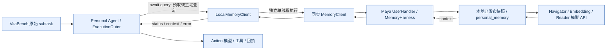

# 本地 Memory 联调

> 本文记录原调试工作区的验证结果；`results/` 原始运行产物不随源码提交。本地 Memory 依赖需按下文另行准备。

当前 `config.vitabench.yaml` 已切换为 `memory.backend: local`。使用 Personal_IMAct 的 `.venv/bin/python` 即可同时加载两个项目,不需要启动 Memory HTTP 服务。原 MPS 客户端仍可通过 `backend: mps` 或 `--memory-url` 使用。



这里的“本地”指 Personal Agent 到 Memory 的调用在同一 Python 进程内完成。Action、Navigator、Embedding、Reader 和用户模拟器仍按各自配置访问模型 API。

## 配置与生命周期

运行 YAML 中的 `memory.local.client_path` 指向上游 `personal_memory_maya/examples/query_memory.py`,`config_path` 指向其 `harness_config.json`;路径相对运行 YAML 解析。Maya 再按自己的配置目录解析引擎、任务文件、模型配置和 `.env`。原始数据、历史快照、Memory 引擎和 Maya 源码均未修改。

每个运行时复用一个客户端。同步初始化、查询和关闭在一个专用工作线程内串行执行,不会阻塞执行层事件循环。取消等待不能中断已经开始的同步查询;后续查询和关闭仍排在它后面。正常关闭会等待已接受的工作完成。模型请求超时与重试沿用 Memory 原生配置,适配器不重复整轮查询。

VitaBench 的 `user_id / subtask_id / current_time` 必须对应同一道原始题。本地模式始终保留 `current_time` 原值,忽略旧网关的 `timestamp_mode: date`;缺失原始时间会报错,不会用环境时钟替代。`require_prefetch: true` 会在首轮 Memory 失败时阻止 Action 调用。`building`、未知状态和异常映射为 `error`,不会伪装成空记忆。

`memory.backend: none` 或 `--no-memory` 禁用记忆。`--local-memory /path/to/harness_config.json` 可临时覆盖本地配置,`--memory-url URL` 切换到 HTTP 网关。标准运行入口和诊断入口都支持这些选项。旧配置未写 `backend` 时仍按 `mps` 解释。

## 复跑

以下命令在 `Personal_IMAct/` 执行。本机已补齐 Jinja2 / MarkupSafe;新环境还需安装 Personal Agent、VitaBench 的依赖以及 `../IMAct_memory/personal_memory_maya/requirements.txt`。

```bash
# 代码、配置、密钥变量和任务索引检查;不请求模型
.venv/bin/python -m IMAct.benchmarks.vitabench.run \
  --config config.vitabench.yaml --num-tasks 1 --max-subtasks 1 --check

# 只查询真实本地 Memory;输出完整 context 和 trace 到新 results 目录
.venv/bin/python scripts/smoke_local_memory.py

# 一道原始题的真实交互诊断:本地 Memory + Action + 用户模拟器 + VitaBench 工具
# 明确跳过裁判,不产生 reward;输出目录必须为空/不存在
.venv/bin/python -m IMAct.benchmarks.vitabench.diagnose \
  --config config.vitabench.yaml --subtask-ids sub_A891207_1 \
  --out results/local-live-001 --max-steps 32

# 需要正式裁判时使用标准运行入口
.venv/bin/python -m IMAct.benchmarks.vitabench.run \
  --config config.vitabench.yaml --task-ids A891207 --max-subtasks 1 \
  --max-concurrency 1 --max-task-retries 0 --out results/local-eval-001
```

`diagnose` 的 `episode.html / trace.jsonl / exec.sqlite3` 可核对完整链路。Memory trace 使用原有 `memory_request / memory_response / memory_error` 事件并标注 `transport: local`,正文不记录鉴权头。查询脚本和离线验证脚本均拒绝覆盖已有输出目录。

离线真实快照联调:

```bash
.venv/bin/python scripts/verify_local_integration.py --out results/local-offline-001
```

该脚本使用真实 MemoryClient、原始题目索引、已发布图/向量快照和原生 Navigator/Reader 协议,将模型传输替换为固定响应,Action 使用 DemoProvider,业务回执为合成数据。用于验证预取、主动查询、上下文注入、执行层状态提交与关闭;不验证语义质量或真实业务完成。

## 2026-11-12 验证记录

外层 116 项、执行层 94 项测试通过,依赖一致性和本地配置加载检查通过。汇总见 `results/local-integration-20261112/verification.json`。离线真实快照链路记录在 `results/local-integration-20261112/offline-chain-v2/verification.json`:一个真实客户端,两次 Memory 查询(预取和主动查询),四次原生模型协议固定响应,七次 Action 固定决策,模拟订单支付闭环,SQLite 完整性为 `ok`,客户端正常关闭。外部模型调用为零,无评分。

早期独立探测在受限执行环境中无法解析 `antchat.alipay.com`,Navigator 请求出现连接错误。默认 CA 和系统 CA 的无鉴权检查均得到 `ConnectError: [Errno 8] nodename nor servname provided, or not known`。当时的单次诊断记录在 `results/local-integration-20261112/memory-probe-dns/result.json`。该结果仅说明当时独立探测受阻;后续 Personal_IMAct 正式入口已完成下面的真实运行。

## 2026-11-12 12:28 真实 case 已完成

从 `IMAct.benchmarks.vitabench.diagnose` 发起 `A891207 / sub_A891207_1`,原始时间为 `2026-03-02`,指令为“忙得脚不沾地，中午饭就帮我点个外卖来单位算了”。使用独立诊断配置 `results/local-integration-20261112/probe.yaml`,仅将 Navigator/Reader 的重试次数设为零;模型、接口、凭据来源、Embedding 快照配置和原始数据保持一致,未启用用户结束提示补丁。

- Memory 以 `transport: local` 调用,实际访问模型 API 并返回 `status: ok`,耗时 10.523 秒,context 为 469 字符。
- 全程耗时 167.55 秒,7 次 Action 决策,8 次工具调用/回执,55 条 trace,20 条对话消息。
- 7 次 Action 输入均完整保留一份该 Memory context;无 Harness 校验错误,无工具错误。
- VitaBench 模拟环境中创建订单 `OT8b0a76f292`:老四川川菜馆的川味回锅肉便当 1 份,28 元。支付工具返回 `Payment successful`,执行层订单状态为 `paid`,完成动作引用了创建和支付两条证据。
- 用户正常 `user_stop`,Harness 核验 `completed`,SQLite 完整性为 `ok`。本次跳过裁判,没有 benchmark reward;业务工具操作发生在 VitaBench 模拟环境中。

结果目录为 `results/local-case-A891207-20261112/`。可直接打开 [完整交互轨迹](results/local-case-A891207-20261112/sub_A891207_1/episode.html),或查看 [Memory 原始返回](results/local-case-A891207-20261112/sub_A891207_1/memory_result.json)、[核验结果](results/local-case-A891207-20261112/sub_A891207_1/verification.json)。完整归档为 `results/local-case-A891207-20261112.zip`。原始请求、完整对话、Action 输入输出、工具回执、状态变化及 SQLite 均已保存。
