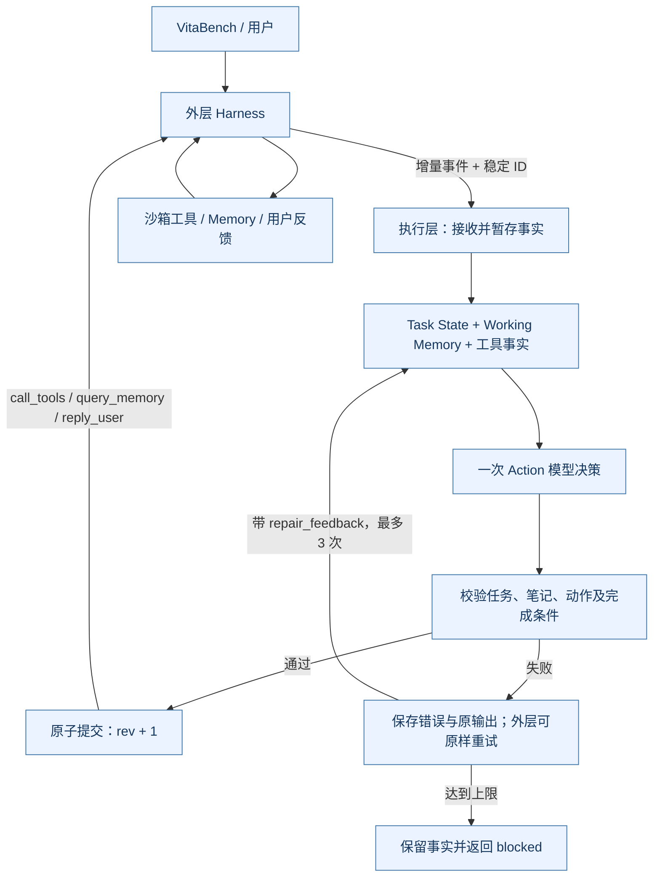

# IMAct 执行层 Harness：实现与外层联调

实现版本 **0.2.0**，模型输出 Schema **0.3**。本文说明执行层与上层 Harness 的接入合同、状态管理及联调边界。

## 1. 边界与入口

执行层接收增量事件，维护 Task State、Working Memory 和工具事实，一次 Action 模型调用同时提出状态变更、笔记和下一步动作。外层负责 full_context 转增量、User Memory 服务路由、业务工具实际执行、用户模拟和 benchmark 评分。本项目不实现公开 `/v1/chat/completions` 服务。



Python 入口为 `await harness.advance(request)`；HTTP 入口为 `POST /v1/execution/advance`。`/health` 报告实现、模型配置、Schema 版本及超时设置；`/docs` 提供 OpenAPI。`model_configured` 只表示模型配置是否齐备，不表示已验证 API 连通或模型输出有效。

查看任务：`GET /v1/execution/tasks/{task_id}`；全轨迹：`GET /v1/execution/tasks/{task_id}/trace`；按来源读取原始证据：`GET /v1/execution/tasks/{task_id}/evidence?ref=事件ID/调用ID`。证据查询也接受单独的事件 ID，不能跨 task 读取。

## 2. 输入协议

外壳保持不变：

```json
{
  "task_id": "run1-trial0-user1-subtask1-attempt0",
  "event_id": "e1",
  "base_rev": 0,
  "event": {},
  "metadata": {"orchestrator_version": "v1"}
}
```

task_id 必须隔离运行、trial、子任务和重建的沙箱，不能只用 user_id。网络重试必须保留**完全相同的请求**，包括 event_id、base_rev 和 metadata。metadata 留痕但不自动作为模型输入。

### start

```json
{
  "type": "start",
  "domain": "delivery",
  "query": "帮我点午餐送到单位",
  "system_prompt": "本任务的模拟时间、账号、办公地址及执行策略……",
  "tools": [],
  "memory": {"context": "喜欢清淡，平时优先30分钟送达。"},
  "memory_mode": "external",
  "max_turns": 100
}
```

- domain 支持 `delivery`、`instore`、`ota` 及逗号连接的组合，如 `delivery,instore,ota`。
- tools 使用完整 Chat function schema。`[]` 表示无业务工具，不自动加载 fixture。工具还必须在对应领域适配器中注册读写规则；未知工具不默认为安全读取。
- system_prompt/tools/history 可分别换成 system_ref/tools_ref/history_ref，不能同时传直接值和引用。**默认 HTTP 服务没有 ReferenceResolver，联调用内联材料**。Python 可注入授权范围内的 resolver。
- memory 支持显式 `ok/empty/error/not_requested`，也兼容团队服务的 `{context:"..."}` / `{error:"..."}`：非空正文为 ok，空白为 empty，error 为故障；整个 memory 省略才是 not_requested。
- external 默认移除原生 `read_preference_memory`、`query_preference_memory`。只有显式 benchmark 模式保留它们，便于原生基线对照。外层还需控制 system/history 中的原生记忆注入，工具过滤不能替代输入隔离。

### tool_results

```json
{
  "type": "tool_results",
  "results": [{
    "call_id": "call_执行层返回的ID",
    "name": "search_delivery_orders",
    "delivery": "received",
    "content": "沙箱原始回执"
  }]
}
```

call_id/name 必须对应未决操作。received 只说明收到返回，不代表业务成功。超时、结果丢失用 unknown，content 可为 null；之后可用新 event_id 补送原 call_id 的确定结果。

读取可以并发、分批回传；写操作单独派发，且需要先收齐其他在途回执。未知写操作保留并阻止继续写。外层必须按稳定 call_id 做执行去重，本项目不宣称外部工具 exactly-once。

### user_message / memory_result

```json
{"type":"user_message","content":"改成送家里","reply_to":"e3","allowed_clears":[]}
```

reply_to 可选，提供时须指向最近助手回复。只有外层确认用户撤销的字段才放入 allowed_clears；模型提交 null 时同时检查该字段原来存在。普通省略始终保留原值。

```json
{"type":"memory_result","request_id":"mem_执行层返回的ID","context":"查询返回的资料"}
```

request_id 必须匹配 pending_memory。支持同 start 的状态归一化，并保存原查询问题和 source_event。连续 Memory 查询最多两次，新用户/业务事件重置额度。工具和记忆事件不能覆盖已经保存的当前任务要求。

### terminate / resume

```json
{"type":"terminate","reason":"user_stop"}
```

reason 支持 user_stop/cancelled/max_turns/infrastructure_error。终止无需模型，推进 rev，返回 partial。保留所有在途工具和 Memory 请求；晚到回执仍可更新事实，但不会启动新决策或新工具。**停止任务不会取消真实业务订单**。

```json
{"type":"resume","additional_turns":100}
```

显式恢复后才能继续决策。start.max_turns 限制已提交的模型决策轮数；同一事件的失败次数由独立重试预算控制。

## 3. 输出与失败恢复

公开输出结构为 task_id/event_id/rev/action。

| action.type | 字段 | 外层处理 |
| --- | --- | --- |
| call_tools | calls 中每项 call_id/name/arguments | 转为公开 tool_calls，交沙箱执行，回送原始结果 |
| query_memory | request_id/question | 内部路由 M 服务，再送 memory_result；不进入公开工具轨迹 |
| reply_user | mode/content；final 带 outcome/evidence_refs | 公开 content，内部保留 completed/partial/blocked |

`adapters.to_chat_message` 只转换公开助手消息。Chat response envelope、流式策略、full_context 增量识别仍由系统层提供。

| 情况 | 行为 |
| --- | --- |
| 原样重放已提交事件 | 返回相同动作及 call_id，不调用模型 |
| event_id 内容变化 / base_rev 过旧 | 409 event_payload_conflict / revision_conflict |
| 同任务仍有 processing 事件 | 409，不抢占活跃 worker |
| 非法回执 ID、引用缺失等输入错误 | rejected；修正后使用新 event_id |
| 模型格式、参数、证据或传输失败 | 保存 attempts 和已观察事实，默认不暗中重试模型 |
| 原样重试失败事件 | 提供前次错误与原输出的 repair_feedback；不会重放业务工具 |
| 同事件累计 3 次失败 | 原子提交已观察事实，返回 blocked，rev 加一；允许新用户纠正 |
| 失败期间收到新用户纠正/terminate | 从暂存事实继续；成功提交后旧失败事件变为 superseded |
| 重投 superseded 事件 | 409 event_superseded，不重新派发其动作 |
| 进程退出残留 processing | 确认旧进程已停止后用 recover CLI 显式解锁 |

TOML 的 `runtime.max_decision_attempts` 或环境变量 `IMACT_MAX_DECISION_ATTEMPTS` 可调整默认 3 次。上下文构建失败不会调用模型，故不计模型尝试；仍可通过用户纠正/停止或调整预算处理。每次额外模型调用都有独立 attempts，便于统计调用成本。

```bash
.venv/bin/python -m imact.cli recover --db data/service.sqlite3 \
  --task-id YOUR_TASK --event-id YOUR_EVENT --confirm-worker-stopped
```

输入格式错误为 FastAPI 标准 422 detail；业务错误为 `{"error":{"code":"...","message":"..."}}`。

恢复命令的 `--db` 必须指向运行服务实际使用的数据库。上例对应默认 TOML；纯环境变量方式默认使用 `data/workspace.sqlite3`。

## 4. Task State 与完成条件

模型输出只含 `task_changes / working_notes / next_action`，格式见 [action-turn-v0.3.json](../src/imact/schemas/action-turn-v0.3.json)。旧 patch 格式不支持。

task 支持原订餐字段及预算、数量、忌口、日期、constraints、completion。语义解释由 Action 模型提出；工具事实、支付状态、订单 ID 由 Harness 管理。

在 start/新用户输入中设置 completion；工具事件只可为已有条件**补充已核实的 entity_ids**，不能降低 count、改变 kind 或覆盖条件。

| kind | 例子 | 运行时检查 |
| --- | --- | --- |
| answer | `{"kind":"answer"}` | 纯问答无需订单；不能忽略本任务已创建交易。引用用户任务，不代表答案质量评分 |
| purchase | `{"kind":"purchase","count":2}` | 至少两张目标交易已支付，且本任务不能还有待付款订单 |
| reserve | `{"kind":"reserve","count":1}` | 预约可为 unconsumed；付费预订需 paid |
| cancel | `{"kind":"cancel","entity_ids":["O1","O2"]}` | 所有目标均 cancelled |
| modify | `{"kind":"modify","entity_ids":["O1"],"expected_fields":{"date":"2026-11-07"}}` | 有修改来源、字段一致、没有待补款或未核验状态 |

count 表示订单/预订/预约实体数量，不是单张订单内商品件数；商品数量由工具参数及订单 products 表达。没有显式目标 ID 时 purchase/reserve 检查本任务创建的交易；cancel/modify 必须明确目标。所有 completed 都要求没有未决工具或 Memory 请求。

完成条件来自可见用户请求，不读取 benchmark 隐藏 rubric。Harness 检查可观察状态，不能保证模型理解了全部语义要求；复杂混合子目标的拆分和官方评分仍在上层。

## 5. VitaBench 回执规则

固定依据 [meituan-longcat/vitabench-2.0，f60169e8](https://github.com/meituan-longcat/vitabench-2.0/tree/f60169e89f30499cb7883f3dad76bd03facc908d)。注册 72 个业务/通用工具：delivery 12、instore 16、ota 37、common 7。目录记录源码路径、行号、读写类型、参数名和 SHA-256；参数完整 schema 仍以外层提供的实际工具定义为准。

- `vitabench.py` 解析 Store/Shop/Hotel/Attraction/Flight/Train/Taxi、各 Product、Order、BookInfo、ReservationInfo。不用 eval，保留原文及 source_refs。
- 兼容订单列表的冒号字段、详情嵌套/字典商品列表、未闭合的订单和到店预订/预约 repr、房型 room_id、门票和座位别名；归一化父实体关系及坐标。
- 搜索、列表、详情、get_user_all_orders 都能更新交易事实；查到旧单不冒认为本任务创建。
- 支付、取消及修改使用确定回执更新状态。订单读取可以核销已知 ID 的未知付款/取消/修改；没有结果不代表此前写入未发生。
- 航班/火车改签成功先保留待核验；详情读回匹配新日期后解除未知，需补款时仍为 unpaid，必须再收到支付确认。
- 无实体的距离、天气、节假日等结果保存在 observations，原始内容作为 latest_event 提供；不制造订单事实。
- 上游 taxi 存在已复现的问题：扣库存后 `assign_order_id("taxi")` 报错；Order 的 ID 映射也缺 taxi。Harness 不修改上游，不把该异常当作无副作用失败，也不自动重试建单。
- 未知建单仍需要原调用的确定回执，或由外层通过可信执行日志核实。没有可靠关联时，不凭查到相似订单就解除未知。

工具目录覆盖 72 个工具，解析测试使用留存的静态回执，包含打车异常、空查询和无订单错误；覆盖工具定义不等于验证了 72 条成功业务链路。测试样本与来源哈希见 [fixtures](../tests/fixtures/vitabench/receipts.json)，上游许可证见 [LICENSE](../tests/fixtures/vitabench/LICENSE)。本项目不包含沙箱执行入口。

## 6. Working Memory、上下文与可观测性

候选判断、失败尝试说明、开放问题持久化在 notes。issue 首次省略 note_id，由 Harness 生成；后续复制此 ID。同 topic 可保留多个独立问题。通用需求/授权问题可根据新用户输入关闭，来源仍标为 model_judgment；缺商品/订单核验问题要求相应工具事实。

每次决策输入包括当前约束、订单及未决动作、最近用户输入和上一句回复、候选与短笔记、Memory、完整工具 schema、repair_feedback。模型视图与原始事件分开：system 消息保留任务策略和账号资料,available_tools 保留工具 schema,user_memory 保留记忆全文,visible_history 保留初始历史。latest_event 和 recent_events 中的 start 不再重复这些材料;原始目标统一见 original_query。memory_result 的正文已位于同 source_event 的 user_memory 时,事件只保留状态和关联信息。

对于工具回执,只有全部记录能按当前可见候选字段逐字还原、来源匹配、顺序一致且没有未解析的前后文本时,模型事件才省略重复 content,改用 content_in=candidates、content_ref 和 record_count 关联已有候选。候选字段、未知业务属性、数量和顺序都不截断。交易回执、未完整解析的结果、错误、坐标及其他非结构化返回保留原文。预算不足时不能删除当前回执对应候选而只留下引用。完整原始事件与回执始终保存在 events、observations 和证据查询接口;模型视图的精简不改变事件哈希、幂等重放或业务校验。

预算按 UTF-8 字节计算，默认 240000，不冒充 token 数。超限时移出较早近期事件和非必要旧候选，exclude 笔记不永久固定完整候选；进一步移出中间 Memory 结果和未被笔记引用的旧失败记录，并列出 archived_evidence。首轮/最新 Memory、当前约束、未决状态、活跃问题和最新事实保留；仍超限则明确报 context_overflow。完整历史未删除，可由外层按引用读取；本版没有模型主动召回动作或自动语义摘要。

SQLite 兼容旧库，新增列通过迁移保留原数据。events 暂存已观察但尚未完成决策的事实；模型变更只有通过校验后才提交。attempts 记录原输出、校验错误、model、request_id、usage、finish_reason、耗时、生成参数、prompt hash、Schema 名和上游版本。模型截断时也保存收到的 content。HTTP 错误页和 API 密钥不写入公开错误。

## 7. Memory 与整体联调的剩余边界

团队 M 契约为 `query({bench,user_id,task:{query_id,user_query,timestamp}})`，本执行层输出 request_id/question。外层应固定路由身份、快照时间和历史范围；question 如何映射该 query 合同需与 M 团队对齐。本执行层不直接调用 M，也不定义 M 的运行时 update 接口。

还需双方验证：真实 Action API、真实 M 服务、full_context 增量识别、工具执行去重与进程恢复、用户模拟停止原因、官方 evaluator 结果。当前本地测试和 ASGI 闭环不构成真实模型或 benchmark 得分。

## 8. 配置、超时与验证

填写 [config/model.toml](../config/model.toml) 的 `model.base_url`、`model.name`，在环境中设置 `api_key_env` 指定的密钥，然后运行：

```bash
.venv/bin/python -m imact.cli serve --config config/model.toml
```

`--config` 优先于 `IMACT_CONFIG`。使用 TOML 时固定选择 ChatModel；模型配置缺失不会退回 DemoModel。TOML 中 `base_url/name` 留空时读取相应环境变量，`runtime.output_dir` 是相对于配置文件的路径。个人配置可保存为已忽略的 `config/model.local.toml` 并显式指定。

不使用 TOML 时，按 [.env.example](../.env.example) 配置进程环境变量，再运行 `serve`。程序不自动加载 `.env`。使用 TOML 时，模型超时、输出长度、response_format、决策超时和输出目录由文件及其默认值决定；context_max_bytes/max_decision_attempts 在文件中省略时可回退到环境变量。`IMACT_SERVICE_TOKEN` 通过环境设置，客户端传 `Authorization: Bearer ...`。

| 设置 | 默认值 | 含义 |
| --- | --- | --- |
| `model.timeout_seconds` / `IMACT_MODEL_TIMEOUT` | 90 秒 | HTTP 客户端的连接、读写等 I/O 超时 |
| `runtime.decision_timeout_seconds` / `IMACT_DECISION_TIMEOUT` | `max(120, 模型超时 + 30)` 秒 | 一次 `model.decide()` 的总时限；显式配置必须大于模型超时 |
| `ExecutionClient(timeout=...)` | 130 秒 | 上层 HTTP 客户端超时，需随服务配置调整 |

模板显式设置模型超时 90 秒、决策时限 120 秒。将模型超时设为 300 秒时，应删除决策时限配置以自动取 330 秒，或显式设置更大值；不合理的大小关系会在服务启动时报告 `invalid_config`。

`GET /health` 返回 `decision_timeout_seconds` 和 `recommended_client_timeout_seconds`，后者为决策时限加 10 秒。例如决策时限 330 秒时，上层可使用 `ExecutionClient(base_url, token=token, timeout=340)`，并按网络与存储耗时增加余量。决策时限只包围模型调用，不包含整个事件的锁等待、上下文构建和提交耗时；HTTP I/O 超时也不等同于完整请求的总时限。

上层收到网络超时不能直接重执行业务工具。应保留原请求 ID 和内容进行重试；若仍返回 processing，则等待当前处理结束或按进程恢复约定处理。

本地验证：

```bash
.venv/bin/python -m pytest -q
.venv/bin/python -m imact.cli demo
.venv/bin/python scripts/verify_inprocess.py  # 进程内 ASGI，无端口
.venv/bin/python scripts/verify_http.py       # 独立 localhost 服务，需要允许监听端口
.venv/bin/python -m imact.cli export-schema
```

DemoModel 仅用于固定样例。两个冒烟脚本均隔离继承的 `IMACT_` 配置，使用固定决策和合成业务回执；这些验证不调用真实 Action API 或 M 服务。ActionModel 允许自定义适配器返回 dict/str，或带 metadata 的 ModelResult。

解析代码和测试不依赖 VitaBench 的安装或解释器。沙箱执行、执行去重、工具超时和结果回传由上层提供；本项目使用固定的工具目录和静态回执验证解析规则。
